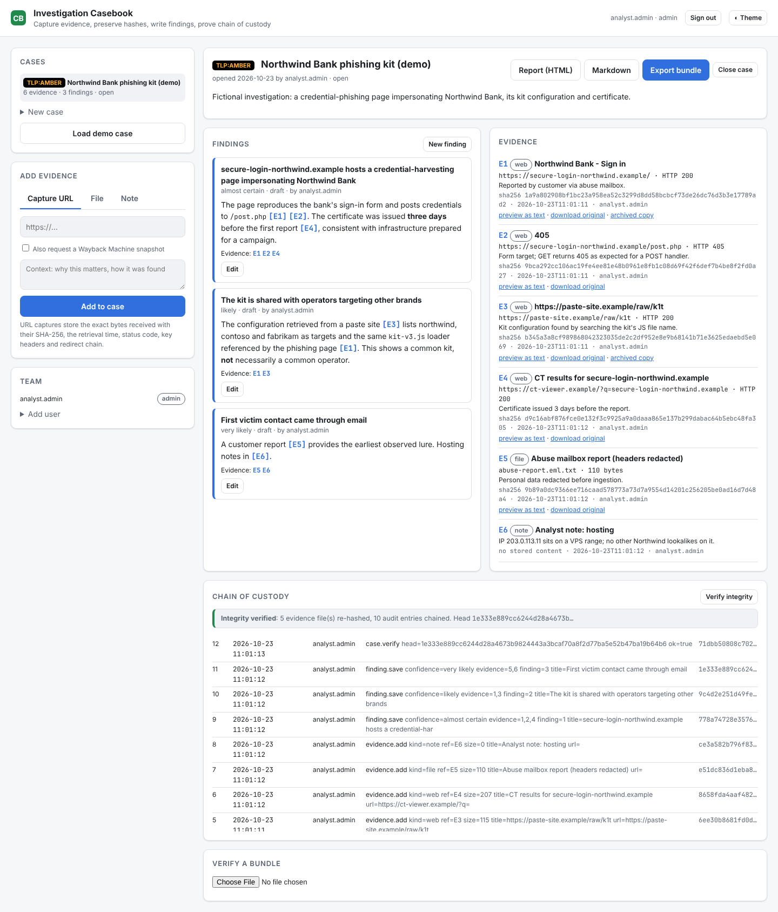

# OSINT Investigation Casebook

**An investigation workspace that covers the whole analyst workflow: capture evidence with retrieval times and preserved hashes, write findings that cite it, prove chain of custody, and hand over a report bundle anyone can verify.**



## Features

* **Accounts and roles.** The first run creates an admin. Admins add **analysts** (write), **reviewers** (approve findings) and **viewers** (read-only). Passwords are hashed with scrypt; sessions are random tokens stored hashed, in HttpOnly SameSite=Strict cookies (`--secure-cookie` behind HTTPS).
* **Saved cases** with a TLP marking (CLEAR / GREEN / AMBER / AMBER+STRICT / RED), status and summary.
* **Evidence capture**
  * **URL**: the exact bytes received are stored in a **content-addressed store** (the file name *is* its SHA-256). The record keeps retrieval time, analyst, HTTP status, final URL, redirect chain and key headers, and you can optionally request a **Wayback Machine** snapshot as an independent third-party copy.
  * **Files** (screenshots, exports, PDFs) and **notes**, hashed the same way.
  * Captured pages are **never rendered** in the app. You can preview them as text or download the original as an attachment, because hostile markup stays inert.
* **Findings** written in plain language with estimative confidence ("almost certain" … "very unlikely"), citing evidence as `[E1]`. A finding can only cite evidence from its own case.
* **Four-eyes review**: a reviewer, never the author, approves a finding. Editing it returns it to draft.
* **Chain of custody**: every action goes into an append-only, **hash-chained audit log** (each entry includes the previous entry's hash). **Verify integrity** re-hashes every stored file and recomputes the chain, so altering a file, editing a log entry or deleting one is detected and reported.
* **Reports**: Markdown, and printable self-contained HTML with the TLP banner, findings with linked citations, an evidence register with hashes and the custody log.
* **Portable bundles**: a zip containing `manifest.json`, every evidence file, both reports and `SHA256SUMS`. `casebook verify-bundle case.zip` (or the UI) checks every file against the manifest and the hashes recorded at capture, without needing access to your server.

## Quick start

```bash
git clone https://github.com/Sentinel1569/osint-casebook.git && cd osint-casebook
python -m venv .venv && source .venv/bin/activate
pip install -e ".[dev]"
python -m casebook serve          # http://127.0.0.1:8000 → create admin → "Load demo case"
```

```bash
python -m casebook user add rita --role reviewer
python -m casebook verify 1                      # re-hash evidence + audit chain (exit 1 on failure)
python -m casebook export 1 -o case-1.zip
python -m casebook verify-bundle case-1.zip
```

| Variable | Default | Purpose |
|---|---|---|
| `CASEBOOK_DB` | `casebook.db` | SQLite database |
| `CASEBOOK_STORE` | `evidence_store/` | Content-addressed evidence files |

Back up the database and the evidence store together. For production, run behind HTTPS with `--secure-cookie`.

## Demo case

A fictional phishing-kit investigation (`.example` domains, served from bundled fixtures): the phishing page and its form handler, a kit configuration on a paste site, a CT lookup, a redacted abuse report and an analyst note, plus three findings with different confidence levels, one of which explicitly separates "shared kit" from "shared operator".

## Data handling

Capture only what the investigation needs. Redact personal data before ingesting it (as the demo's abuse report shows), apply TLP markings honestly, and follow your organisation's retention rules.

## Tests

```bash
make test && make lint
```

The tests cover roles and the four-eyes rule, tamper detection (modified file, edited audit entry), bundle verification and cross-case citation rules.

## License

MIT
